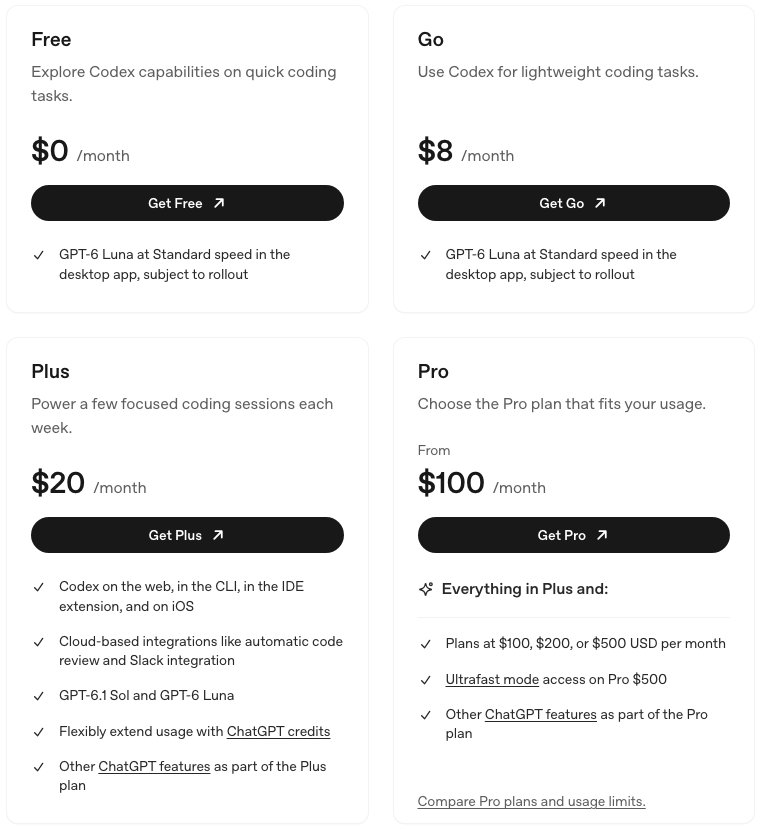
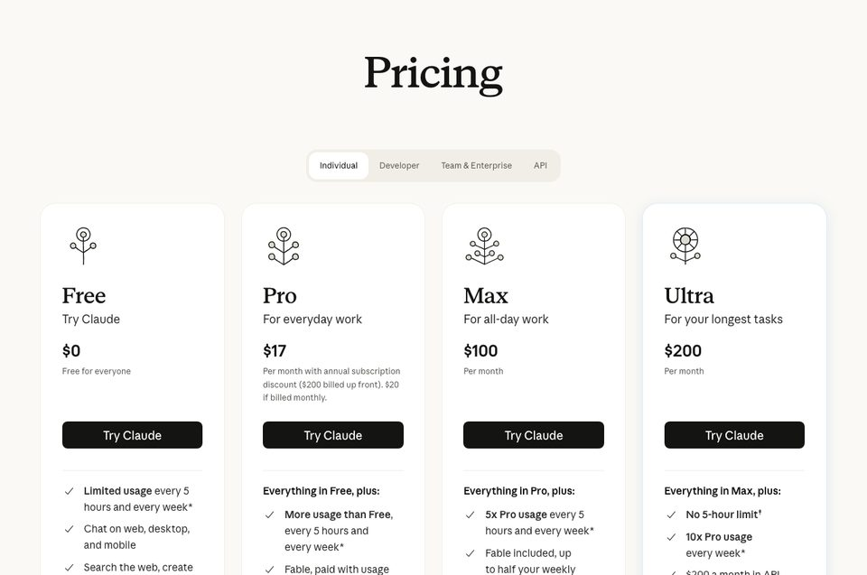
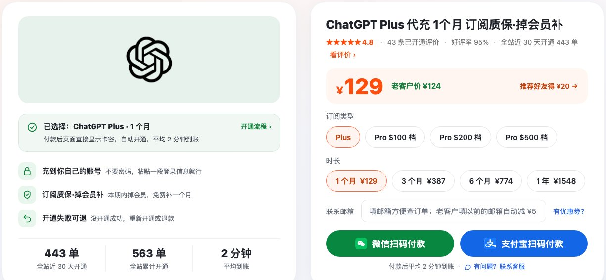
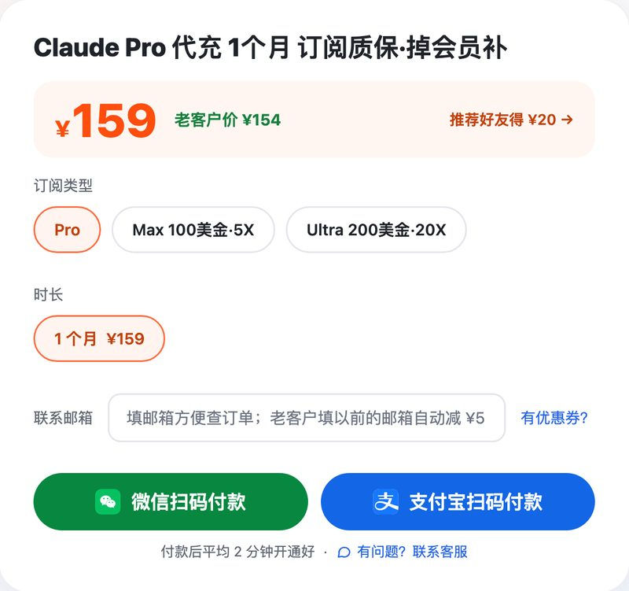

# ChatGPT Plus、Claude Pro 国内开通教程 2026：支付宝可付

> 2026-11-02 整理 · 价格和规则以官方页面、商品页当天显示为准

ChatGPT 和 Anthropic 官方都不支持中国大陆地区，国内的银行卡、支付宝、微信在官网结账页都付不了。手上没有海外卡，想给自己的账号开 ChatGPT Plus 或 Claude Pro，常见的路有四条：找人替你付、开在你自己账号上；虚拟信用卡；App Store 礼品卡；合租共享账号。我统计不出大家用 GPT 的多还是用 Claude 的多，所以这篇两个一起写。

**先说结论：**

- **不想折腾，选第一条**：瑶瑶ai训练师的店用支付宝、微信充值，[ChatGPT Plus 一个月 ¥129](https://kw.yaoyao.chat/item/5?utm_source=aitools&utm_medium=github&utm_campaign=gh2611&utm_content=top-plus)，[Claude Pro 一个月 ¥159](https://kw.yaoyao.chat/item/12?utm_source=aitools&utm_medium=github&utm_campaign=gh2611&utm_content=top-claude)。结账时填券码 **ikaijua**，每单少 ¥3。官网两家都是每月 20 美元，要海外卡。
- **怎么开、多久好**：会员落在你现在用的账号上，以前的对话都在。gpt plus 付完款页面直接出卡密，拿卡密加一段登录信息去充值页自助提交；claude 订阅这边，先在 claude.ai 注册好，付完款在订单页填组织 ID。两边都不交密码，店里写的是平均 2 分钟开好。
- **出问题怎么办**：没开成的重新开或退款；本期会员里掉回免费版，补一个月；ChatGPT 账号出了问题，可以协助重新注册；企业微信客服 24 小时在线。
- **靠不靠谱**：11-02 我翻了她的商品页：全站近 30 天开通 444 单（全店所有商品合计）；ChatGPT Plus 这个商品有 43 条已开通评价、平均 4.8 星，全店合计 53 条、4.9 星。能开发票，也能对公转账。
- **顺带的**：Codex 跟着 ChatGPT Plus（也有人写成 gptplus）走，Claude Code 跟着 Claude Pro 走，都不用另外买。

## 方法一：找瑶瑶ai训练师开到自己账号（最省心）

**核心思路**：你出人民币，店家去官方付会员费，会员落在你自己注册的账号上。账号、对话、设置都还是你的，跟合租账号是两回事。

**适合**：

- 没有海外卡，也不想研究虚拟卡、美区 Apple ID；
- 用安卓、Windows，手边没有苹果设备；
- 今天就想用上；
- 要开发票报销，或者走对公转账。

### chatgpt plus 多少钱：gpt plus、claude pro 官网价和店里价

| 档位 | 官网月费 | 瑶瑶ai训练师（支付宝 / 微信） | 带不带写代码的工具 |
|---|---|---|---|
| ChatGPT Plus | 20 美元 | ¥129；3 个月 ¥387、6 个月 ¥774、1 年 ¥1,548 | 带 Codex，终端、编辑器、网页、手机都能用 |
| ChatGPT Pro | 三档：100、200、500 美元 | ¥699 / ¥1,399 / ¥3,499 | 带，用量更大 |
| Claude Pro | 20 美元（按年一次付 200，折合每月 17） | ¥159 | 带 Claude Code |
| Claude Max | 100 美元，5 倍 Pro 用量 | ¥900 | 带 |
| Claude Ultra | 200 美元，每周用量是 Pro 的 10 倍 | ¥1,800 | 带 |

几点说明（官方价 11-02 看的 [Codex 定价页](https://developers.openai.com/codex/pricing) 和 [Claude 定价页](https://claude.com/pricing)）：

- ChatGPT 免费版和 Go 也能用 Codex，但只在桌面 App 里，还在逐步放开；终端和编辑器里用，从 Plus 起。
- Claude 免费版没有 Claude Code，Pro 起才有。
- Ultra 官方写的是已验证账号没有 5 小时上限。
- 店里 Plus 可以一次选好 3 个月、6 个月或 1 年，下单页同一页切换。

*图：ChatGPT 个人档官方价，Plus 那张卡列着 CLI 和编辑器插件，来源 OpenAI Codex 定价页，11-02 截图*

*图：Claude 个人档四档官方价，来源 Claude 定价页，11-02 截图*

### ChatGPT Plus 怎么开（5 步）

1. **看账号状态**：chatgpt.com 设置里的订阅那一栏，得是免费版。还有没到期的 Plus 或 Pro，现在交会提示已有订阅，卡密不会被扣，等到期再交。
2. **下单**：选 Plus 和时长，填券码 **ikaijua**，支付宝或微信扫码。付完页面上就是卡密，记下来。
3. **拿登录信息**：在电脑上登录 chatgpt.com，不换浏览器，新开标签页访问 `chatgpt.com/api/auth/session`，页面上那一大段文字全部复制。
4. **提交**：去充值页 cz.yaoyao.chat，卡密和刚才那段文字各填一格，看一眼页面认出的邮箱是不是你的，再提交。店里提醒复制后 1 分钟内交；放久了会提示过期，开无痕窗口重新登录再复制就行，卡密不扣。平均 2 分钟后刷新 ChatGPT，订阅写着 Plus 就好了。
5. **收尾**：ChatGPT 设置 → 安全，点「退出所有设备」。店里商品页的说法是，点完以后你交出去的那段文字就作废了。在这一页把多因素认证（MFA）也开上：照 OpenAI 的 Codex 登录文档，账号里有邮箱+密码这种登录方式的，不开 MFA 进不了 Codex。

第 3 步那段文字不是密码，是你这次登录的凭证，充值就靠它开到你的账号上；开好以后做完第 5 步，它就作废了。

*图：瑶瑶ai训练师的 ChatGPT Plus 下单页，微信、支付宝扫码付，11-02 截图，单数以当天页面为准*

### Claude Pro 怎么开（4 步）

1. **准备账号**：claude.ai 上要有一个你自己注册、能正常登录的号。这个号如果已经是 Pro 或 Max，就没法再往上开，换个没会员的号。
2. **下单**：同一个下单页切 Pro、Max 100 美元档、Ultra 200 美元档，填券码 **ikaijua**，扫码付款。
3. **填组织 ID**：claude.ai 左下角头像 → 设置 → Account，有一行 Organization ID，复制下来，贴到订单页的填写框里提交。组织 ID 只是一个编号，别人拿着它登不进你的账号，也看不到你的对话。
4. **确认**：平均 2 分钟开好。退出 Claude 再登一次，套餐名变成 Pro 就成了；还是 Free，先核对登录的邮箱是不是复制组织 ID 的那个号。

要用 Claude Code 的，开好以后在终端输入 `claude`，浏览器里登这个号就行。不考虑别的因素，写代码我觉得 Claude Code 好用一些；日常问答、写东西、做图，ChatGPT Plus 更均衡。

*图：瑶瑶ai训练师的 Claude 下单页，三档同页切换，11-02 截图*

### 店里写明的规则

- **开不成**：没开上的，重新开或者退款，按你的意思来。
- **掉会员**：开成后在本期会员有效期内变回免费版，凭订单号和截图，给同一个账号补一个月。
- **账号出问题**：ChatGPT 账号出了状况，可以协助重新注册一个号（以商品页写的为准）。
- **续费**：钱不走你的银行卡，不会自动扣款，到期想续再下一单。
- **客服**：只有企业微信一个入口，全天有人，扫码页 kw.yaoyao.chat/wecom。
- **发票**：能开，也能对公转账，下单后把订单号和抬头发给客服。
- **评价**：要付了款、开通成功才能评，差评不删，评价页 kw.yaoyao.chat/pingjia。
- **券码**：**ikaijua** 每单减 ¥3，每单限用一次，不和老客户减 ¥5 叠加。

**好在哪**：不用海外卡，支付宝、微信就能付；会员开在自己账号上；平均 2 分钟开好；能开票；规则写在商品页上，企业微信随时找得到人。

## 方法二：虚拟信用卡

**核心思路**：在国内能申请的平台开一张海外虚拟卡，到官网自己绑卡订阅。

**适合**：本来就要给好几个海外服务付钱、愿意自己研究卡和账单地址的人。

- **好处**：在官网自己付，订阅、取消都自己管；一张卡还能付别的海外服务。
- **麻烦**：开卡费、充值手续费、月费加起来不少；卡段被拒很常见，第一次扣款成功，下个月续费也不一定成功；平台关停了，卡里的余额不好取。要准备哪些东西，我在讨论区 [#1025](https://github.com/ikaijua/Awesome-AITools/discussions/1025) 写过一遍，步骤很多。

## 方法三：App Store 礼品卡（美区 Apple ID）

**核心思路**：用美区 Apple ID 买礼品卡充余额，在 ChatGPT 或 Claude 的 iOS App 里内购订阅。

**适合**：手上有 iPhone、对切换 Apple ID 地区不陌生的人。

- **好处**：走的是官方 App 和苹果内购，订阅在 Apple 账户里就能管。
- **麻烦**：得有苹果设备；礼品卡常有溢价；刚充值就付款、新号、IP 来回变，容易被苹果的购买风控锁住，解锁要找苹果客服，可能等两三天。完整步骤同样在 [#1025](https://github.com/ikaijua/Awesome-AITools/discussions/1025)。

## 方法四：合租共享账号

**核心思路**：几个人凑钱用同一个会员账号，卖家给你邮箱和密码。

**适合**：只想看一眼会员界面、什么私人内容都不输的人。

- **好处**：最便宜，登上就能用。
- **麻烦**：同车的人能看到你的对话、你传的代码和文件；卖家随时能改密码；多地同时登录容易触发验证甚至被限；号没了很难追回。工作资料、代码、简历这类东西，别放进共享账号。

## 怎么选

| 方法 | 难度 | 账号是谁的 | 花费 | 适合谁 |
|---|---|---|---|---|
| 找瑶瑶开到自己账号 | 低 | 你自己的 | Plus ¥129、Claude Pro ¥159，填券码再减 ¥3 | 没有海外卡、想当天用上、要发票 |
| 虚拟信用卡 | 高 | 你自己的 | 20 美元 + 开卡和手续费 | 常买海外服务、愿意折腾 |
| App Store 礼品卡 | 中 | 你自己的 | 20 美元 + 礼品卡溢价 | 苹果用户 |
| 合租共享账号 | 低 | 不是你的 | 最便宜 | 只想看看、不输隐私内容 |

一句话：手里有官网收的海外卡、人也在官方支持的地区，就去官网；剩下的情况，第一条最省事。

## 常见问题

**Q：chatgpt plus 多少钱一个月？**

A：官网 20 美元一个月。在瑶瑶ai训练师店里用支付宝、微信付是 ¥129，填 **ikaijua** 是 ¥126；3 个月 ¥387、6 个月 ¥774、1 年 ¥1,548。

**Q：gptplus、gpt plus、chatgpt plus 是一回事吗？**

A：是一回事，都是 ChatGPT 的 Plus 档。Codex 不单卖，Plus 里就有，聊天和 Codex 用同一个账号的额度。

**Q：claude pro 和 Claude Code 要分开买吗？**

A：不用。Pro、Max、Ultra 都包含 Claude Code，跟网页版共用额度；Free 档没有它。

**Q：找人开 ChatGPT Plus，交出去的登录信息安全吗？**

A：那段文字不是密码，是你这次登录的凭证，充值靠它开到你的账号上。开好后在安全设置里点「退出所有设备」，按店里的说明它就失效了。瑶瑶这边全程不要密码、不要验证码。

**Q：claude 订阅找人开，要不要密码？**

A：不要，只要组织 ID。它是一个编号，拿它登不进你的账号。

**Q：已经是 Plus 或 Pro 会员了，还能再开吗？**

A：同一个号上不能叠加。ChatGPT 那边会员没到期就交，系统会拦下来，卡密照样留着，到期后再交；Claude 要换一个当前没有会员的号。

**Q：会自动续费扣钱吗？**

A：不会。这条路不绑你的卡，用一个月买一个月。官网绑卡订阅才是默认自动续费。

**Q：能开发票吗？**

A：能，也能对公转账。下单后把订单号和抬头发到企业微信 kw.yaoyao.chat/wecom，票种开票前确认。

## 总结

国内开 ChatGPT Plus、Claude Pro，先看三件事：**会员是不是开在自己的账号上、开不成和掉会员怎么处理、要你交出去的东西安不安全**。

- 有海外卡、人在支持地区：官网自己订。
- 苹果用户愿意折腾：App Store 礼品卡，步骤看 [#1025](https://github.com/ikaijua/Awesome-AITools/discussions/1025)。
- 没有海外卡、想今天就用上、要开票：找瑶瑶ai训练师，[ChatGPT Plus ¥129](https://kw.yaoyao.chat/item/5?utm_source=aitools&utm_medium=github&utm_campaign=gh2611&utm_content=end-plus)，[Claude Pro ¥159 / Max ¥900 / Ultra ¥1,800](https://kw.yaoyao.chat/item/12?utm_source=aitools&utm_medium=github&utm_campaign=gh2611&utm_content=end-claude)，结账填 **ikaijua** 减 ¥3。
- 合租账号别放隐私内容。

## 相关阅读

- [Awesome-AITools](https://github.com/ikaijua/Awesome-AITools)：ChatGPT、Claude、Codex 那几行的介绍
- 走官方渠道的完整步骤（美区 Apple ID、礼品卡、海外卡）：[开通 ChatGPT/Claude 订阅经验 #1025](https://github.com/ikaijua/Awesome-AITools/discussions/1025)
- 卡密交上去报错了怎么办：[ChatGPT充值教程](https://github.com/yaoyao-chat/chongzhi)（瑶瑶ai训练师整理）
- Plus 里都有什么、买几个月合适：[ChatGPT Plus购买指南](https://github.com/yaoyao-chat/plus)，瑶瑶ai训练师写的
- Plus、Pro 各带多少 Codex 额度：[Codex订阅价格](https://github.com/yaoyao-chat/codex)（瑶瑶ai训练师整理）
- Pro 100、200、500 美金三档差在哪：[ChatGPT Pro价格](https://github.com/yaoyao-chat/gpt-pro)（瑶瑶ai训练师整理）
- 国内给 ChatGPT Plus 充值的完整流程：[GPT代充教程](https://github.com/haiwaihuyonghui-rgb/gpt-chongzhi)（瑶瑶ai训练师整理）
- 想多比几家再下单：[ChatGPT代充平台横评 2026](https://github.com/yaoyao-chat/daichong)（瑶瑶ai训练师整理）
- 四家 AI 会员的开通教程合在一处：[ChatGPT / Claude / Grok / Gemini 充值教程合集](https://github.com/yaoyao-chat/yaoyao-chat.github.io)（瑶瑶ai训练师整理）

## 核对与来源

- [Codex 定价页](https://developers.openai.com/codex/pricing)：Free、Go、Plus 20 美元、Pro 100 / 200 / 500 美元，免费版和 Go 的 Codex 只在桌面 App 且逐步开放，Plus 起有 CLI、编辑器插件、网页、iOS（2026-11-02）
- [Codex 登录说明](https://developers.openai.com/codex/auth)：邮箱加密码登录的账号要先开 MFA 才能用 Codex（2026-11-02）
- [Claude 定价页](https://claude.com/pricing)：Pro 20 美元、按年 200 美元，Max 100 美元 5 倍，Ultra 200 美元每周 10 倍、已验证账号没有 5 小时上限，Free 不带 Claude Code（2026-11-02）
- 店里的价格、开法、售后、客服、发票、444 单和评价数：11-02 读的 Plus、Claude 两个商品页和页面上的事实卡
- 苹果礼品卡购买风控、虚拟卡的细节：我在讨论区 [#1025](https://github.com/ikaijua/Awesome-AITools/discussions/1025) 的整理

价格和规则会调整，下单前以当天页面为准。
